<!--
theme: fhtw
footer: 'Accessible Webtechnology – Lesson 4'
paginate: true
title: Accessible Webtechnology – Lesson 4
_footer: ''
_class : lead
-->

# Accessible Webtechnology - Lesson 4

Selected topics

---
## Lesson 4 Overview

### Your Questions
* how to manage many components?
* how to work together (Code)?
* current job descriptions for web developers? What is used (CMS or own developments)?

### Selected topics
* **Project management**: organizing work packages and issues (for integrating your feedback from your user study)
* **Deployment**: how to bring an app to production and make it available for others
* **Accessibility**: automated accessibility testing - pros and cons

---

<!--
_footer: ''
_class : lead
-->

# Components
Single-File Components, Organizing components

---

## Vue.js Single-File Components (SFC)

Vue.js has the concept of **Single-File Components** with HTML, JavaScript and CSS in one `.vue` file:

```html
<template>
  <p class="greeting">{{ greeting }}</p>
</template>

<script>
export default {
  data() {
    return {
      greeting: 'Hello World!'
    }
  }
}
</script>

<style>
.greeting {
  color: red;
  font-weight: bold;
}
</style>
```

---

## Vue.js Single-File Components - pros and cons

### Pros
* everything of the component in one file
* easier to transfer and reuse components
* component-scoped CSS

### Cons
* requires a **build step**
   * the browser does not understand `.vue` files
   * a tool like [webpack](https://webpack.js.org/) is needed to transfer `.vue` files to something the browser can understand
   * **more complexity**, therefore I didn't use it for this lecture

---
## Vue.js Single-File Components - real-life example

A real-life example of Single-File Components:
* [search bar Single-File Component](https://github.com/asterics/AsTeRICS-Grid/blob/master/src/vue-components/components/searchBar.vue)
* [usage of the component in a search dialog](https://github.com/asterics/AsTeRICS-Grid/blob/master/src/vue-components/modals/searchModal.vue#L12)

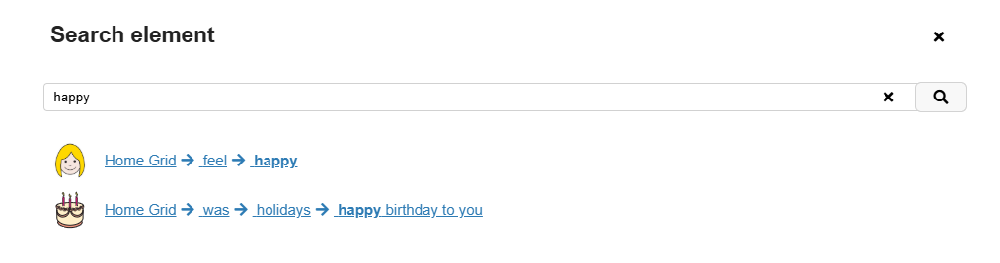

---

## Organizing components

Big apps will have many components - some hints for managing them:

* **Sensible splitting**: keep components as big as possible, split if sensible:
   * e.g. start with a search dialog component with integrated search bar
   * extract the search bar later, if you need it at another location too
* **Naming**:
   * keep naming consistent with the UI
   * name components in a way which automatically groups related components
* **Folders**: move related components into folders

---

## Organizing components - edit element example

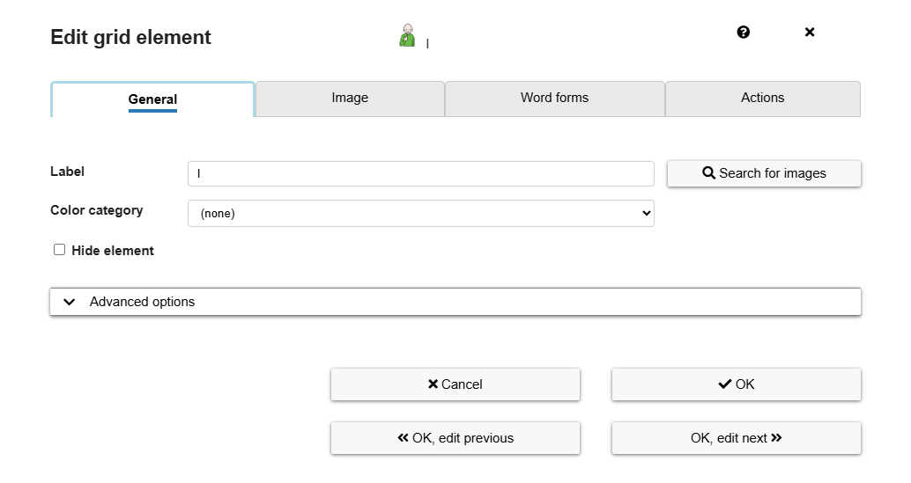

---

## Organizing components - edit element example (2)

This *edit element* dialog is implemented in these files:
* `editElement.vue`: whole dialog
* `editElementGeneral.vue`: tab *General*
* `editElementImage.vue`: tab *Image*
* `editElementWordForms.vue`: tab *WordForms*
* `editElementWordActions.vue`: tab *Actions*

This naming **groups elements** in alphabetic ordering (because of equal start of the names) and is **consistent with the UI**.

See [folder containing these elements on GitHub](https://github.com/asterics/AsTeRICS-Grid/tree/master/src/vue-components/modals).

---

## Organizing components - folders

There is not one correct folder structure, every sensible grouping helps, e.g. these folders:

* `dialogs`: for all components which are dialogs
* `views`: containing all views (pages) of the app
* `components`: containing shared components used at multiple places

See [example of folders for components on GitHub](https://github.com/asterics/AsTeRICS-Grid/tree/master/src/vue-components).

---

<!--
_footer: ''
_class : lead
-->

# Management of a web project
Git, GitHub, Managing Issues

---

## Git

* Software initially developed by *Linus Torvalds*, developer of Linux the kernel
* Git is a **Version Control System** (VCS)
* helps to **keep track of code change changes** and **collaborate with others**

Basic terms of Git:
* **Repository**: name for a Git-based project
* **Commit**: a specific frozen state of the whole codebase
* **Branch**: a named timeline of commits

---

<div class="columns-1-3">
   <div>

## Git branches

Multiple branches for different developments.

The base of a branch is a specific commit.

Image from
[https://git-scm.com/](https://git-scm.com/book/en/v2/Git-Branching-Branching-Workflows)
   </div>
   
   <div>
      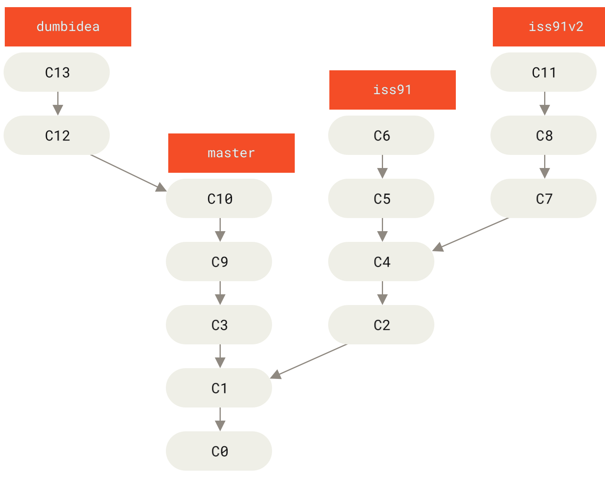
   </div>
</div>

---

<div class="columns-1-3">
   <div>

## Git merge

Two branches can be merged resulting in a commit that has two parent commits.

Image from
[https://git-scm.com/](https://git-scm.com/book/en/v2/Git-Branching-Branching-Workflows)
   </div>
   
   <div>
      
   </div>
</div>

---

## GitHub

Important to distinguish:
   * **Git**: tool for version control, which works fully offline
   * **GitHub**: online platform where it's possible to publish Git-based projects

There are many additional features of GitHub (not all directly related to `Git`):
* **Pull Requests**: manage comparison and merging of Git *branches*
* **Issues**: part for organizing issues and bug reports
* **Discussions**: forum-like part for discussions of the community
* **Projects** and **Milestones**: for organizing the work on issues
* **GitHub Pages**: host your website


---

## Try GitHub and Git

* Sign up: https://github.com/signup
* Install Git client for your computer: https://git-scm.com/install/
* Create a new repository:

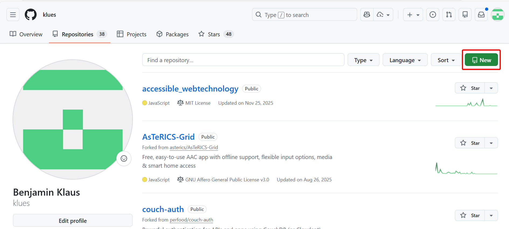

---

## Add your project to GitHub repository (1)
Download (*clone*) the new repository to your computer:
* find the link to clone: 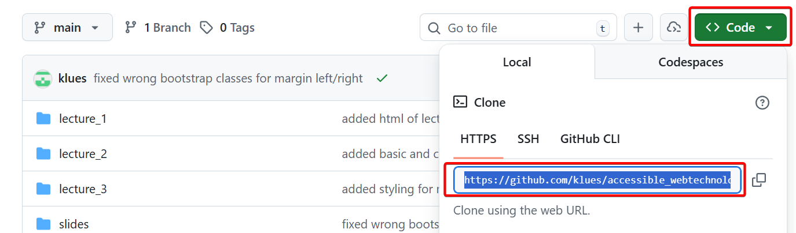
* right click in some location in your file explorer and select `Git Bash here`: 

---

## Add your project to GitHub repository (2)

* in Git bash type command `git clone <your-project-url-from-github>`

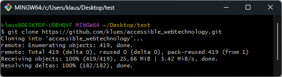

* copy the files of your project to the cloned folder
* *commit* and *push* your files (we'll do it together)

---

## GitHub Issues

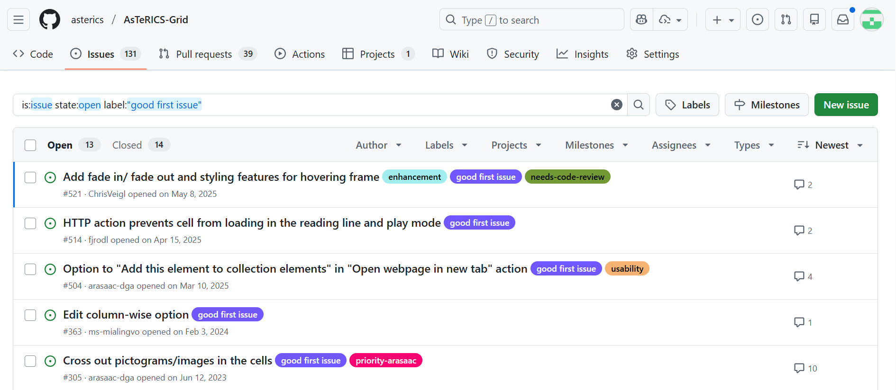

---

## How to create issues

There are two common types of issues: **bug reports** and **feature requests**.

<div class="box box-warn">
  ⚠️ <strong>Important</strong>: An issue should always cover just one topic. Do not cover multiple (non-related) ideas or bugs in a single issue.
</div>

<div class="columns">
   <div>
      
### Bug reports
* report that something is not working
* should include:
   * **Steps to reproduce**: how to get to the error?
   * **Expected behaviour**: how should it work?
   * **Actual behaviour**: what is happening instead?
   </div>
   
   <div>

### Feature requests
* idea for new features
* should include:
   * **Motivation**: why do we need the feature?
   * **Proposed solution**: how could the implementation work or look like?
   </div>
</div>

---

## Create your first issue

Go to your GitHub project and create an issue based on the user feedback you got from your usability test (course *UX Aspects*):

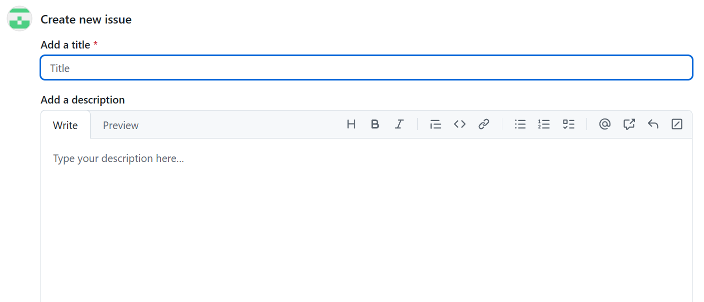

---

## Managing Issues

These GitHub features can help to manage issues:
* **Labels**: you can assign labels like `bug`, `feature`, or `good first issue` to your issues for quickly organizing them
* **Milestones**: help to manage issues that should be done for a specific milestone (with `due date` and possibility to order issues)

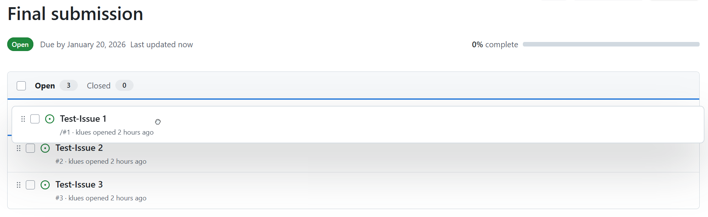

---

## Kanban board

GitHub also allows to create *Projects*, e.g. as *Kanban Board* which help to track the current work of all team members:

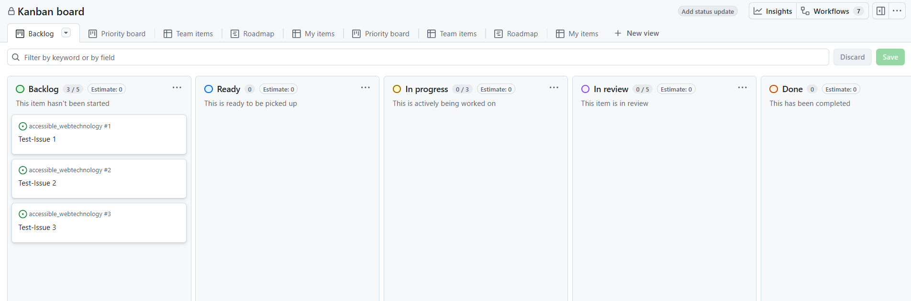

---

## Collaborating on code

Git helps teams work together on the same codebase.

Typical workflow:
* **Select issue**: a person selects an issue to work on
* **Create a branch**: a separate branch for each issue helps to prevent conflicts while working
* **Work on the issue**: and commit results to the separate branch
* **Create a Pull Request**: when the work is done, a *Pull Request (PR)* asks other people to review the code changes
* **Code Review**: an other person reviews the code and maybe proposes changes
* **Merge**: the Pull Request is *merged* into the *main* branch, indicating that the changes are going to be released
* **Close issue**: after finishing the work, the issue is closed

---

## [Pull request example](https://github.com/asterics/AsTeRICS-Grid/pull/710)

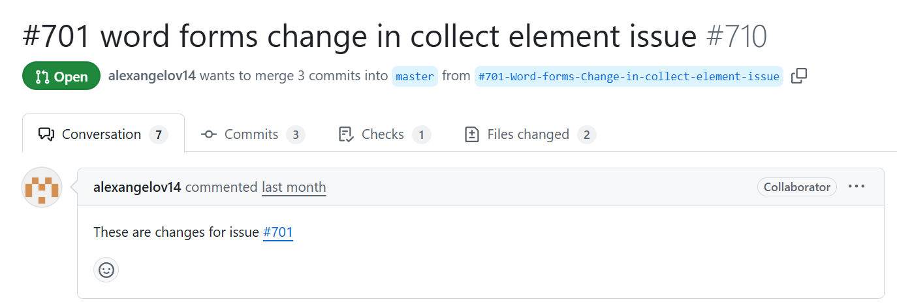

--- 

## [Pull request example - code diff](https://github.com/asterics/AsTeRICS-Grid/pull/710/files)

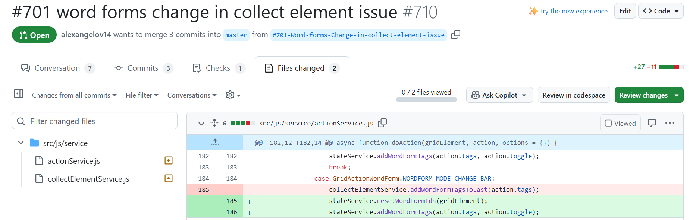

---

<!--
_footer: ''
_class : lead
-->

# Low cost deployment
How to run an app with > 100 000 users at low cost

---

## GitHub Pages

GitHub Pages provides a **web server** which can provide static content **for free** (e.g. also your web application from this lecture):

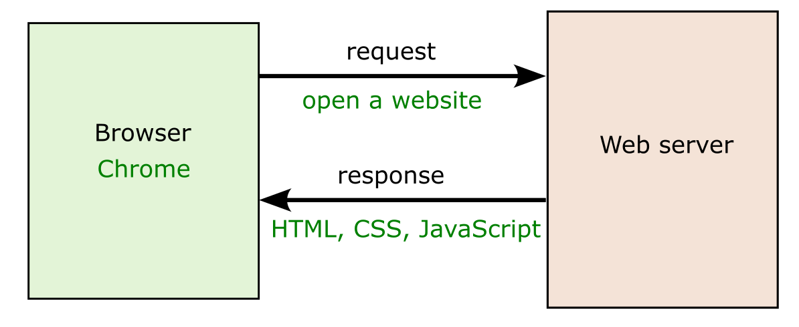

**No database**: all dynamic data must be stored on the client or on an external server.

---

## Asterics AAC

* web app for *Augmentative and Alternative Communication (AAC
* helps people to communicate, who cannot speak
* mainly developed at *UAS Technikum Wien* in research projects, see [funding history](https://github.com/asterics/AsTeRICS-Grid?tab=readme-ov-file#acknowledgements-and-attribution)

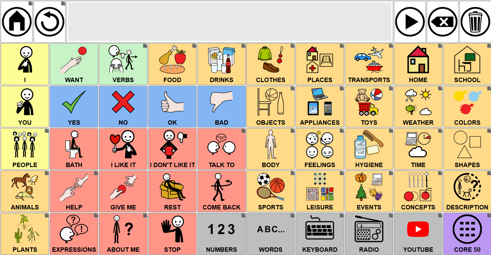

---

## Asterics AAC - user statistics 2025

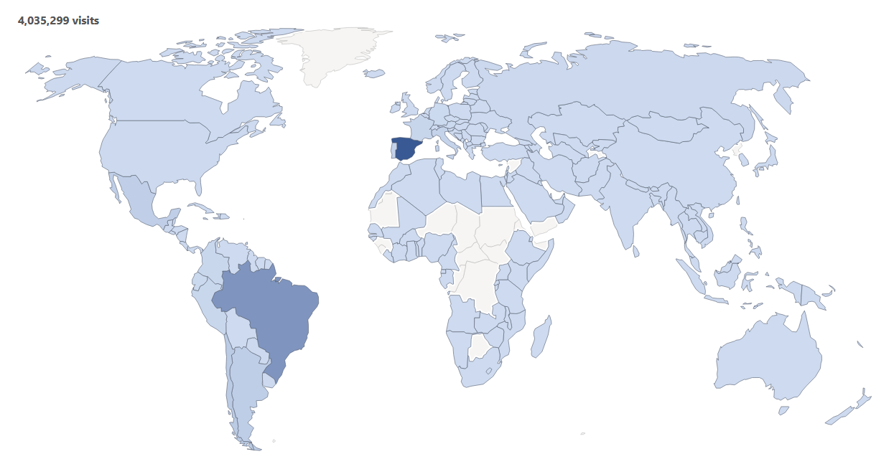

---

## Asterics AAC - architecture

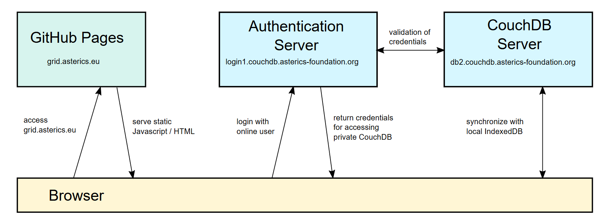

---

## Activate GitHub Pages for your project

* Go to GitHub settings and enable Pages: 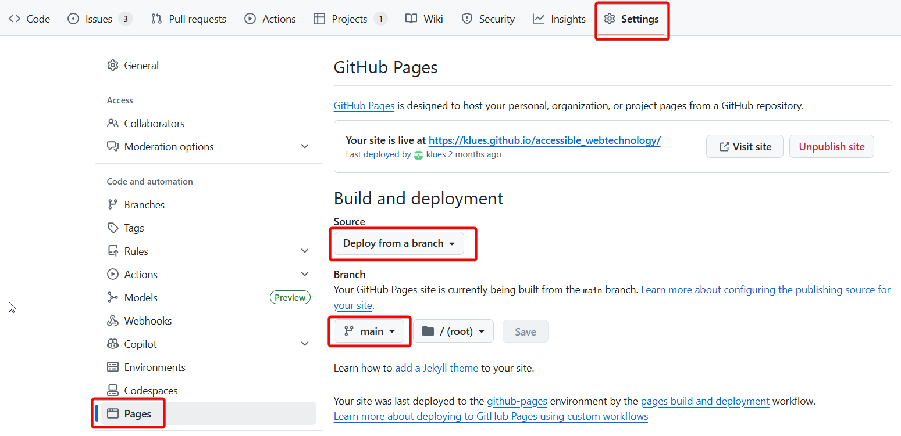

---

## Activate GitHub Pages for your project (2)

* Navigate to the link provided, add the path to the entry point to your app
   * e.g. `https://klues.github.io/accessible_webtechnology/` and then add `lecture_3/example_solution/indexNavbar.html`
   * full link e.g. https://klues.github.io/accessible_webtechnology/lecture_3/example_solution/indexNavbar.html

* if you want no extra path, you can add the entry point `index.html` to the root folder of the project

---

<!--
_footer: ''
_class : lead
-->

# Automated accessibility testing
Google Lighthouse, WAVE

---

## Google Lighthouse

Find it in Google Chrome developer tools (`Ctrl + Shift + I`) in Tab `Lighthouse`.

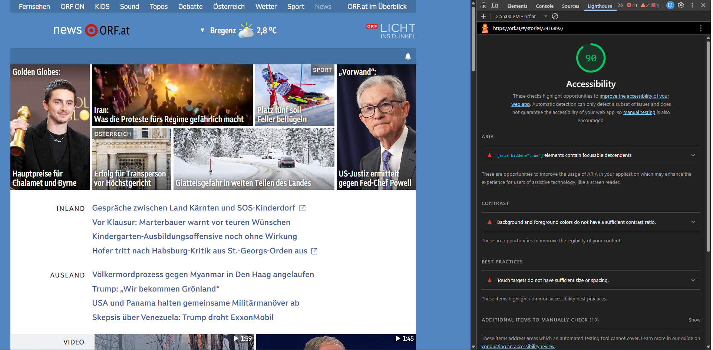

---

## WAVE accessibility evaluation tool

Available as browser extension or directly on webpage: https://wave.webaim.org/

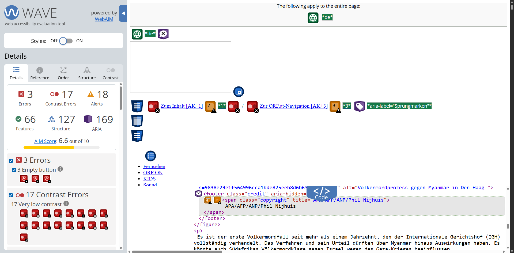

---

<!--
_footer: ''
_class : lead no-fhtw-logo
-->

<h1>
<div>Benefits and drawbacks of </div>
<div>automated accessibilty testing</div>
</h1>

What do you think?

---

## Limitations of automated accessibility tests

* meaningful `alt` texts for images?
* meaningful link texts?
* do header texts make sense?
* are error messages accurate?
* is keyboard tab order logical?
* are content languages correct?
* are aria-roles used correctly (is something with `role="button"` really something button-like)?
* ...


<div class="box box-info">
  ℹ️ According to a <a href="https://webaim.org/projects/practitionersurvey3/">WebAIM survey from 2022</a> most accessibility practitioners thought that <b>only 20-30%</b> of all accessibility issues can be <b>detected automatically</b>.
</div>
